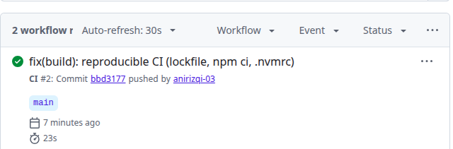
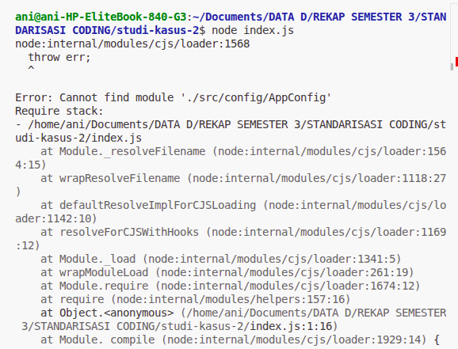
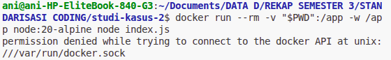
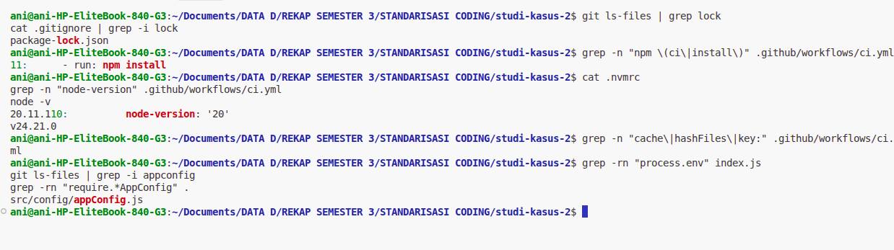
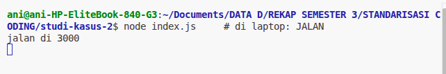
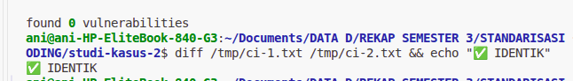

# Laporan: Studi Kasus 2 — Build Tidak Reproducible

**Nama:** ⟦Ani Rizqi ZIarotus Sunani⟧
**NIM:** ⟦E41251131⟧
**Kelas:** ⟦D⟧
**Tanggal:** ⟦2026-11-22⟧
**Repo GitHub:** ⟦https://github.com/anirizqi-03/studi-kasus-2.git⟧
**Commit diperbaiki:** ⟦hash commit, mis. a1b2c3d⟧

---

## Daftar Isi

1. [Tujuan](#1-tujuan)
2. [Environment](#2-environment)
3. [Langkah & Perintah](#3-langkah--perintah)
4. [Hasil](#4-hasil)
5. [Kesimpulan & Refleksi](#5-kesimpulan--refleksi)

---

## 1. Tujuan

1. Mereproduksi kegagalan build di CI yang tidak terjadi di laptop developer ("jalan di laptop, gagal di CI").
2. Mendiagnosis akar masalah melalui **5 langkah diagnosis berurutan** (lockfile → perintah install → versi Node → cache → environment/nama file).
3. Menerapkan perbaikan standar agar build **reproducible**: lockfile ter-commit, `npm ci`, `.nvmrc`, dan cache key berbasis lockfile.
4. Membuktikan pipeline kembali hijau dan build identik antar-run (checksum identik).

---

## 2. Environment

### 2.1 Lokal

| Item | Nilai |
| :--- | :--- |
| OS | ⟦mis. Ubuntu 22.04 / macOS 14.5 / Windows 11 + WSL2⟧ |
| Node | ⟦output `node -v`, mis. v20.11.1⟧ |
| npm | ⟦output `npm -v`, mis. 10.2.4⟧ |
| Docker | ⟦output `docker -v`, mis. Docker version 27.0.3⟧ |
| Git | ⟦output `git --version`, mis. git version 2.43.0⟧ |

### 2.2 CI

| Item | Nilai |
| :--- | :--- |
| Runner | `ubuntu-latest` (GitHub Actions) |
| Node | dari `.nvmrc` = ⟦isi, mis. `20.11.1`⟧ |
| Perintah install | `npm ci` |
| Cache | `actions/setup-node` cache `npm` (key otomatis dari `package-lock.json`) |

### 2.3 Struktur project (ringkas)

```text
studi-kasus-2/
├── .github/workflows/ci.yml
├── .nvmrc
├── .gitignore
├── index.js
├── package.json
├── package-lock.json
├── src/config/appConfig.js
└── docs/laporan-studi-kasus-2.md

## 3. Langkah & Perintah
Pengerjaan dibagi menjadi 6 tahap. Setiap tahap menyertakan perintah persis yang dijalankan.

### 3.1 Tahap 0 - Setup repo dengan bug disengaja

mkdir -p ~/studi-kasus-2 && cd ~/studi-kasus-2
git init
npm init -y
npm install express --save-exact
mkdir -p src/config .github/workflows docs

File yang dibuat:

.nvmrc → 20.11.1

.gitignore → node_modules, .env, *.log

src/config/appConfig.js → module.exports = { port: 3000 };

index.js → memanggil require('./src/config/AppConfig') (sengaja kapitalisasi salah)

.github/workflows/ci.yml → versi awal (salah) memakai npm install, node-version: '20'

Commit awal:
git add .
git commit -m "chore: initial setup (buggy CI)"
git remote add origin ⟦URL_REPO⟧
git branch -M main
git push -u origin main


### 3.2 Tahap 1- Reproduksi kegagalan

node index.js

# Simulasi Linux (CI): GAGAL
docker run --rm -v "$PWD":/app -w /app node:20-alpine node index.js


### 3.2 Tahap 2 - Diagnosis 5 langkah
# 1. Cek lockfile ter-commit
git ls-files | grep lock
cat .gitignore | grep -i lock

# 2. Cek perintah install di CI
grep -n "npm \(ci\|install\)" .github/workflows/ci.yml

# 3. Cek versi Node
cat .nvmrc
grep -n "node-version" .github/workflows/ci.yml
node -v

# 4. Cek cache CI
grep -n "cache\|hashFiles\|key:" .github/workflows/ci.yml

# 5. Cek environment & nama file (akar masalah)
grep -rn "process.env" index.js
git ls-files | grep -i appconfig
grep -rn "require.*AppConfig" .


### 3.4 Tahap 3 - Perbaikan

sed -i "s|./src/config/AppConfig|./src/config/appConfig|" index.js

### 3.5 Tahap 4 - Verifikasi lokal
# Linux sekarang sukses
docker run --rm -v "$PWD":/app -w /app node:20-alpine node index.js

# Checksum reproducible
rm -rf node_modules
npm ci
find node_modules -type f -exec sha256sum {} \; | sort > /tmp/ci-1.txt

rm -rf node_modules
npm ci
find node_modules -type f -exec sha256sum {} \; | sort > /tmp/ci-2.txt

diff /tmp/ci-1.txt /tmp/ci-2.txt && echo "✅ IDENTIK"

### 3.6 Tahap 5 - Push & Bukti CI hijau
git add .
git commit -m "fix(build): reproducible CI (lockfile, npm ci, .nvmrc)"
git push




### 3.7 Tahap 6 - Commit laporan
git add docs/laporan-studi-kasus-2.md
git commit -m "docs: laporan studi kasus 2"
git push

## 4 Hasil










## 5 Kesimpulan & Refleksi

###5.1 Yang dipelajari
- "Jalan di laptop" bukan bukti reproducible — harus diuji di environment target (Linux/container).

 - Diagnosis sistematis 5 langkah mencegah tebak-tebakan: cek fondasi (lockfile → install command → runtime → cache) sebelum mencurigai kode.

 - Error pertama di log CI hampir selalu akar masalah; membaca log dari atas jauh lebih efisien.

-  Perbedaan case-sensitivity filesystem adalah penyebab klasik "jalan di laptop, gagal di CI" yang mudah direproduksi lewat Docker.

-  npm ci + lockfile + .nvmrc adalah trio minimum untuk build reproducible.

